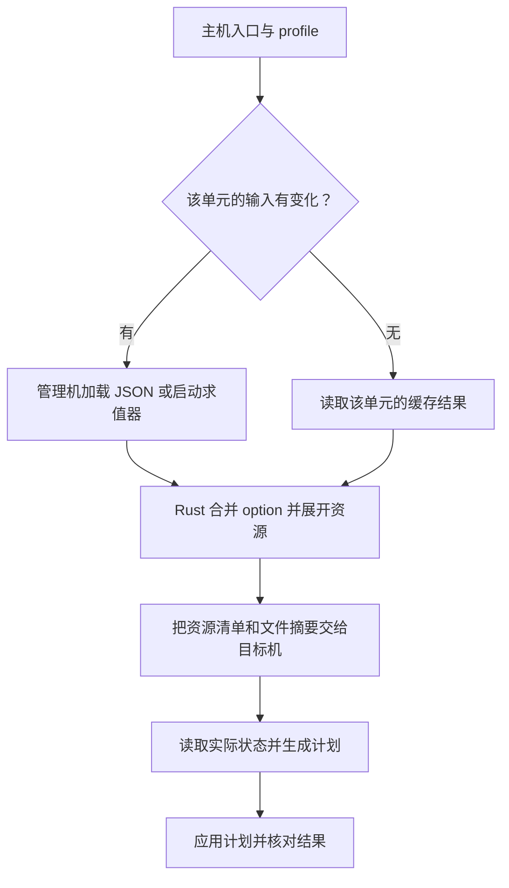

# dek · 声明式主机配置管理器设计

**命令名**：`dek` ｜ **版本**：v0.16（需求核对稿） ｜ **日期**：2026-11-22

在一个 Git 仓库中管理多台主机，每台主机有独立的配置入口。用户通过类似 NixOS 的 option 描述主机状态，由 Rust 核心合并配置、计算差异并执行变更。首版支持静态 JSON 与 Ruby；管理机可通过 SSH 管理远端 Arch Linux 主机。日常修改单个配置文件时，只重新计算受影响的部分。

> 说明：第 1 节为已敲定的设计边界；其余章节中的接口命名、目录布局与工程流程为当前首版方案，尚未拍板的细节集中列于第 11 节。

## 1. 已确定的设计边界

| 事项 | 决定 |
|---|---|
| 核心与语言 | Rust 实现核心。语言求值器通过紧凑、带版本的 JSON 交换数据。首版直接解析静态 JSON，Ruby 通过独立子进程求值，后续按同一协议接入 TypeScript。 |
| 配置组织 | 一个仓库管理多台主机，每台主机一个入口。内置模块随主程序发布，用户模块可在仓库内注册，二者共用相同的 option、合并和资源接口。 |
| 平台范围 | 首版交付 Linux，首个支持的发行版为 Arch Linux。为后续 macOS、Windows 分别预留管理端和目标端接口，各平台按自身能力独立实现。 |
| 多机管理 | 首版支持本机和 SSH 两种模式，均提供 `plan` 和 `apply`。远程模式下在**管理机**完成求值，目标机只接收资源声明及其引用的静态文件内容；目标机信息通过 SSH 显式采集。 |
| 软件包 | 跟随 Arch 滚动更新，配置只声明包名和来源，不维护软件包版本锁文件。官方仓库包由 pacman 管理，AUR 的源码构建、安装与升级委托给现有 helper，首个适配器采用 paru。 |
| 应用与移除 | `apply` 默认补装声明中缺少的软件包；若补装需要升级系统，先展示完整升级计划。移除声明后仅停止管理，卸包、删文件、停止服务和禁用自启均需显式声明。 |
| 选项命名 | 公开 option 优先沿用 NixOS 已有的完整路径、拼写与大小写，所有配置语言共用同一 schema。 |
| SSH 与密钥 | 管理用户 SSH 授权公钥；支持将私钥加密后提交至仓库，目标机在 `apply` 时用预置的解密私钥将其解密并落盘至声明路径。 |
| 账户与目录 | Linux 首版支持创建和配置本地用户、组及目录，并支持用户级服务和定时器依赖这些资源。 |
| systemd 范围 | Linux 首版支持系统级 unit，也支持为指定目标用户部署并启用用户级 service 和 timer。 |
| 缓存 | 管理机按仓库和求值单元保存二进制缓存文件。Rust 将校验后的输出与依赖摘要编码为 MessagePack，负责全部缓存读写；首版不引入 SQLite。 |
| 运行与恢复 | CLI 按需运行。系统快照和回滚继续由用户已有的 Snapper 流程负责；dek 记录每次执行结果并支持失败后重试。 |

### 1.1 平台与资源后端

同一个 Git 仓库可以管理不同平台的主机。在本文中，运行命令的机器称为**管理机**，被查看或修改的机器称为**目标机**；本机执行时两者为同一台设备。首版交付 Linux 管理端与 Arch 目标端。后续扩展新平台的管理端后，即可从该平台管理所有已支持的目标机；新增目标平台则需实现对应平台的资源后端并通过验收。

| 边界 | 职责 | 首版与扩展方式 |
|---|---|---|
| 管理端与共享核心 | 读取仓库、启动语言求值器、合并 option、构建依赖图、展示计划；获取本机缓存目录、管理子进程等平台操作由本地适配层提供。 | JSON/Ruby 求值与 CLI 语义全平台共用。仓库中的源文件路径由管理端解析。 |
| 传输层 | 传递握手信息、目标事实、资源声明、文件内容和执行结果。 | 本机调用与 SSH 复用同一套请求语义；传输方式与目标操作系统解耦。 |
| 目标端 | 上报目标主机标识、系统、发行版、架构、协议版本、可用资源类型与版本；负责目标路径处理、权限校验、实际变更与执行记录。 | Linux 通用接口可供其他 Linux 发行版复用；pacman/AUR 仅属于 Arch 后端。 |
| 资源后端 | 注册带版本的资源类型与可用属性，完成声明校验、读取实际状态、生成动作、执行变更与结果核验。 | 通用文件资源复用基础字段，POSIX 所有者与 mode 由支持的后端实现；systemd unit 与 drop-in 使用 Linux 专用类型。未来可独立增加 launchd 或 Windows 服务资源。 |

例如共享 profile 声明了一项备份任务，模块仅在目标机支持相应能力时才导入 systemd 定时器定义。若用户显式声明了目标机不支持的资源或字段，`plan` 会直接报出主机名、缺失能力与配置来源，且整份计划不可执行。对于需要“按能力启用”的共享模块，作者可显式根据目标能力进行条件分支。单纯凭操作系统名推断 systemd、AUR helper 或特定特性是否可用，在最小化安装或容器环境中容易出错。

目标路径按目标平台的原始格式传输，交由目标端进行规范化和同一性判定，不在管理机提前改写。求值过程中读取过的目标事实与能力均纳入依赖摘要；`apply --plan` 只复核原计划用到的能力、后端版本兼容性及前置条件，目标机新增无关能力不会导致旧计划失效。平台无关的声明仍可跨主机命中缓存。

## 2. 配置结构与写法

| 仓库内路径 | 用途 |
|---|---|
| `dek.json` | 仓库清单：登记主机名到入口文件和 SSH 别名的映射、公共 profile 名称及仓库自定义模块。 |
| `hosts/server/default.rb`、`hosts/laptop/default.json` | 各主机独立选择配置语言。 |
| `hosts/server/Caddyfile` | 随主机配置部署的静态文件，相对路径以声明文件所在目录为基准。 |
| `profiles/base.json` | 公共选项值。Ruby 主机可以引用 JSON profile，反之亦然。 |
| `modules/lab-backup/` | 用户模块的 option 定义与资源展开实现；内置模块随 CLI 提供。 |

例如管理机的 `dek.json` 可以将 `server` 绑定到 SSH 配置中已有的别名 `lab-server`，同时注册一个公共 profile 和一个自定义模块。示例中的 `inputs: "sdk"` 表示该 Ruby 入口约定仅通过 SDK 提供的可追踪接口读取外部输入。

```json
{
  "schemaVersion": 1,
  "hosts": {
    "server": {
      "entry": "hosts/server/default.rb",
      "inputs": "sdk",
      "target": { "ssh": "lab-server" }
    },
    "laptop": {
      "entry": "hosts/laptop/default.json",
      "target": { "local": true }
    }
  },
  "profiles": { "base": "profiles/base.json" },
  "modules": {
    "lab.backup": {
      "schema": "modules/lab-backup/options.json",
      "expand": "modules/lab-backup/expand.rb",
      "readsOptions": ["lab.backup"],
      "inputs": "sdk"
    }
  }
}
```

清单中的文件路径相对于仓库根目录。profile 可用路径简写注册，也可用对象指定入口和输入策略，例如 `{"entry":"profiles/base.rb","inputs":"sdk"}`。SSH 目标默认用逻辑主机名核对目标报告的主机标识。两者不同时，在同一 host 项填写 `"targetId": "实际主机名"`，保留原有 `target.ssh` 别名。

### 2.1 主机入口与公共 profile

以下是首版 Ruby SDK 的典型写法。Ruby 求值器与 DSL 随 CLI 提供，管理机安装 Ruby 后即可运行。

```ruby
# hosts/server/default.rb
profile "base"

service :openssh, enable: true
service :caddy, enable: true, configFile: source_file("./Caddyfile")

configure "lab.backup",
  enable: true,
  directories: ["/srv/projects", "/srv/data"]
```

以下公共选项写在 `profiles/base.json` 中，由 Rust 独立缓存：

```json
{
  "schemaVersion": 1,
  "imports": [],
  "options": [
    { "path": "programs.git.enable", "value": true },
    { "path": "programs.git.config", "value": { "init": { "defaultBranch": "main" } } },
    { "path": "environment.systemPackages", "value": ["ripgrep", "jq"] }
  ]
}
```

`profile "base"` 返回一条引用，由 Rust 负责解析。Ruby 的 `require_relative` 仍可用于共享辅助函数，所引用的本地文件也会计入当前单元的依赖。`source_file` 仅声明待部署文件，由管理机的 Rust 核心在规划阶段读取内容；如果 Ruby 需要读取文件内容参与 option 计算，则使用单独的 `read_text`。区分二者后，日常修改 Caddyfile 即可跳过 Ruby 求值。

JSON 的 `imports` 可写 profile 名称，也可用对象传入命名参数，例如 `{"name":"base","params":{"role":"server"}}`。在同一主机的声明图中，别名和参数相同的引用共用一个采集单元。比较参数时忽略对象键顺序，保留数组元素顺序。

### 2.2 主机、模块和 option

- **host**：决定引用哪些 profile，并提供该主机的覆盖值。显式指定的主机名必须存在于清单中；本机运行时可通过已绑定的本机名自动匹配入口。
- **profile**：提供带来源信息的选项赋值，可嵌套引用其他 profile。Rust 负责展开引用图并检测循环依赖；带参数的引用按参数规范化后的值区分。
- **module**：声明 option 的路径、类型、默认值、合并策略和说明，并将最终生效值展开为资源。注册仅使模块可用，是否启用由对应选项控制。
- **resource**：描述包、用户、组、目录、文件或 systemd unit 的期望状态。唯一标识分别由包来源与包名、账户或组名、目标路径、unit 作用范围与名称决定。服务的“运行状态”和“开机自启”作为两个独立属性建模。

合并优先级统一为 **模块默认值 → profile → host 显式值**。同级标量赋值一致时自动合并，冲突时同时报出双方来源；集合型列表按声明规则去重，有序列表保留顺序；文件内容冲突时同时报出相关模块。

若最终配置不再声明某个包、文件或服务，下一次 `apply` 仅停止管理该资源，不做破坏性清理。卸载包、删除文件需显式声明期望状态为 `absent`；停止服务使用 `running: false`，禁用自启使用 `enabled: false`。例如删掉 Caddy 的整段声明后，已安装的包、配置文件和正在运行的服务都会保留；若其他 profile 仍声明了该服务，则继续按合并后的配置管理。

内置模块以静态 schema 和 Rust 资源展开器的形式随 CLI 发布，仅使用静态 JSON 和内置模块的主机无需安装脚本运行时。用户模块可提供同格式的 schema 与 Ruby 展开器，读取 Rust 合并后的选项并返回同格式的资源（例如 `lab.backup` 展开为定时器、服务与配置文件）。两个模块重复声明同一 option 属于定义冲突，而 host 覆盖该 option 的值属于正常用法。

### 2.3 公共 option 的命名与兼容范围

首版以 NixOS 官方 option 目录作为命名参考：概念一致时直接复用其完整层级、大小写与上游字段名（例如 `users.users.<name>.extraGroups`）。Ruby、静态 JSON 以及后续的 TypeScript 共用同一规范名。`user "alice"` 等 SDK 简写展开后，`dek show` 和错误诊断一律展示完整路径。语言辅助函数、CLI 参数与 Rust 内部字段则遵循各自生态的习惯命名。各模块文档需记录对应的上游路径、值类型和 dek 特有语义，并通过测试确保 Ruby 与 JSON 写法产出完全一致的标准化配置。

| 配置用途 | 公开路径或映射 | dek 在目标机上的含义 |
|---|---|---|
| 本地账户与组 | `users.users.<name>.{isNormalUser,isSystemUser,uid,group,extraGroups,home,shell,description}`、`users.groups.<name>.gid` | `shell` 接受目标机路径，附加组遵循 6.2 节的增量规则。 |
| 安装包 | `environment.systemPackages` | Arch 上为官方仓库包名列表；AUR 包使用扩展项 `dek.arch.aurPackages`。 |
| 服务与应用 | `services.openssh.enable`、`services.caddy.configFile`、`programs.git.config` | Git 默认分支位于 `config` 下的 `init.defaultBranch`；第三方软件配置键保留原拼写。 |
| systemd | `systemd.services`、`systemd.timers`；`systemd.user.services` 与 `systemd.user.timers` 表示面向用户级 systemd manager 的定义 | 特定账户专用的 unit 使用扩展项 `dek.users.<name>.systemd.{services,timers}`。 |
| 目录 | `systemd.tmpfiles.settings.<config>.<path>.d` | Linux 结构化写法使用 `user`、`group`、`mode`；通用 directory 资源的 `owner` 映射到 tmpfiles 的 `user`。 |
| 加密文件 | `age.identityPaths`、`age.secrets.<name>.{file,path,owner,group,mode}` | 参考社区模块 agenix 的命名，路径解析和落盘规则以 6.3 节为准。 |

## 3. 从配置到执行计划



| Rust 数据结构 | 包含的内容 | 使用方 |
|---|---|---|
| `UnitSpec` | profile 引用、逐条 option 赋值、来源文件与行号或 JSON Pointer、求值时读取到的外部输入 | 求值器、合并器、缓存 |
| `HostConfig` | 类型校验后的生效选项、优先级、生效定义及被覆盖的定义 | `show`、模块展开器 |
| `ResourceSet` | 规范化后的资源清单、所需文件摘要、依赖关系与触发条件 | 本地后端、SSH 目标端 |
| `Plan` | 目标主机标识、资源摘要、待执行动作、变更原因及各动作的前置条件 | `plan`、`apply`、重试 |

**第一步：采集声明**  
Rust 从目标 host 出发按需展开。静态 JSON 直接反序列化；Ruby 求值器接收主机、入口和参数，返回逐条赋值。Rust 按入口关系标注来源与优先级层级，统一检查未知 option、类型错误与同级冲突。此阶段仍保留每个 profile 各自的赋值来源。

**第二步：展开资源**  
例如启用 Caddy 会展开为一个仓库包、一个开机自启且应处于运行状态的服务，以及可选的 Caddyfile。模块可声明依赖的 option 路径，Rust 按这些生效值缓存展开结果；未声明精确依赖时，兜底将全部可见选项作为依赖输入。

**第三步：读取实际状态**  
已缓存的 `ResourceSet` 可直接发往目标机。目标端实时读取包数据库、受管文件内容与权限、systemd 启用及运行状态，与期望状态比对并生成差异。即使有人在目标机上手工改过文件或停掉服务，下一次 `plan` 仍能检出。

**第四步：执行并核验**  
`apply` 复核前置条件，按资源依赖顺序执行变更，并在变更后重新读取核验。执行已保存计划时严格使用原计划及其引用的文件摘要；若目标实际状态在审阅后发生了变化，则报出具体冲突并要求重新规划。已满足期望状态的幂等动作直接跳过。

### 3.1 多语言协议

协议 v1 与资源类型由 Rust 核心定义。单次运行中，同一种语言的未命中单元可复用同一个子进程批量求值。管道上的每条消息为单行紧凑 JSON：请求包含 `protocolVersion`、请求 ID、操作名和负载，响应按请求 ID 关联，日志统一输出到标准错误。静态配置文件则通过 `schemaVersion` 管理格式演进。以下是 Ruby 求值器对 `collect` 请求的响应示例（为便于阅读已格式化展开）：

```json
{
  "protocolVersion": 1,
  "id": "collect-server",
  "ok": true,
  "result": {
    "imports": ["base"],
    "options": [
      {
        "path": "services.caddy.enable",
        "value": true,
        "origin": { "file": "hosts/server/default.rb", "line": 5 }
      }
    ],
    "inputs": []
  }
}
```

协议支持“采集选项”和“展开自定义模块”两类操作。求值器可通过请求 ID 反向请求 Rust 获取显式目标信息，并同步记录依赖。即使脚本未调用文件读取 API，入口文件及所有已加载代码文件的摘要也会自动写入该单元的依赖清单。遇到语法错误、运行时异常、协议版本不兼容或输出校验失败时，直接返回出错阶段与源码位置、终止本次规划，且不写入新的成功缓存。

## 4. 按单元的文件缓存

入口或 profile 的声明采集、Rust 选项合并以及各模块的资源展开均独立缓存。规划时从指定 host 沿正向引用遍历依赖，每个单元通过键直接定位到单个缓存文件。配置仓库是唯一事实来源，求值缓存可随时删除并重建。Ruby 求值器不直接触碰缓存文件，只通过 JSON 管道交互。

### 4.1 缓存位置与文件布局

Linux 管理机默认将缓存存放在 `$XDG_CACHE_HOME/dek/<repo-id>/units/<prefix>/<unit-key-hash>.mpk`。仓库标识用于隔离不同的本地工作副本，短前缀用于目录分片。单元键由阶段、规范化单元标识及参数构成：依赖目标主机信息的单元按主机隔离，与目标无关的 profile 可在同一仓库内跨主机复用。文件名取单元键的哈希，以便配置内容变更后仍能定位并覆盖同一单元的历史缓存。

| 缓存文件内容 | 用途 |
|---|---|
| 格式版本、单元标识与求值器签名 | 识别缓存格式变更、SDK 更新及语言运行时版本变化；格式不匹配或解码失败时仅重算该单元。 |
| 依赖清单 | 记录输入类型、标识及上次观测摘要；引用其他单元时记录其键和语义输出摘要。 |
| 语义输出摘要 | 对对象键排序并对无序集合规范化，同时保留有序数组顺序，用于判断上游变更是否需要继续向下游传播。 |
| 已校验输出与来源信息 | 由 Rust 序列化为 MessagePack。固定结构按字段位置编码，用户自定义键值表保留原键名；来源位置变化时同步更新诊断信息。 |

缓存未命中时，Rust 将求值器返回的 JSON 转为类型化数据，校验后编码落盘；命中时直接解码文件。以第 3.1 节响应示例中的 `result` 为例，紧凑 JSON 占 143 字节，保留键名的 MessagePack 占 110 字节，固定结构按位置编码仅占 59 字节。以上仅统计单条载荷体积，文件头、依赖清单、文件系统实际占用及端到端耗时将在原型阶段单独基准测试。

### 4.2 命中与失效规则

1. **采集节点**：从目标 host 的采集节点出发，检查入口文件、实际加载的代码、SDK 读取的文件或目录清单以及显式读取的目标事实。“目标文件不存在”同样记录为一项依赖，一旦该文件随后出现即触发失效。采集结果中的 `profile "base"` 仅记录引用，因此即使 `base` 的选项改变，只要主机入口自身输入未变，入口的 Ruby 采集结果仍可直接复用。
2. **合并与展开节点**：Rust 沿本次采集到的引用访问所需 profile；输入变化的单元重新求值并替换依赖集合，动态增删的引用在当次运行立即生效。合并节点校验被引用单元的输出摘要，展开节点校验所读取生效选项的摘要。若上游语义输出未变，仅更新自身依赖与来源位置即可，下游继续命中缓存。
3. **原子写入**：将结果、来源与最新依赖清单写入同目录下的临时文件；提交前获取该单元写锁，复核计算所基于的输入与当前磁盘记录，确认有效后原子重命名替换，过期计算结果直接丢弃。即使写入意外中断，其他读取操作仍能读到上一个完整版本；缓存文件损坏时按单元局部重建。
4. **状态隔离**：目标机实际状态的核验始终发生在计划阶段。目标机另行保存执行日志与待重试服务动作，清空管理机求值缓存不会丢失失败任务的恢复上下文。

| 变更或输入类型 | 预期行为 |
|---|---|
| 仅修改 `hosts/laptop/default.json`，随后规划 `server` | `server` 的已命中单元直接复用，无需启动 Ruby。 |
| 修改 `base` 中的 Git 选项 | 下次规划相关主机时仅更新 `base`；Caddy 生效选项未变，继续复用其资源展开结果。 |
| 修改通过 `source_file` 声明的 Caddyfile | Rust 更新文件内容摘要并计算目标差异；只要 Ruby 未主动读取内容，其求值单元保持命中。 |
| 使用 `read_text`、受控环境变量读取或目录遍历 | SDK 自动记录内容、值或目录成员摘要，文件编辑、重命名与删除均可触发失效。 |
| 通过 SDK 获取 HTTP 输入 | `refresh` 显式拉取并更新已声明的外部输入，日常求值复用本地缓存；初次使用或缓存缺失时明确提示缺少哪项输入；响应更新后仅使依赖它的单元失效。 |
| 原生 Ruby I/O、时间、随机数或外部进程 | 允许在配置中直接使用。动态单元默认每次运行都重新求值；只有显式标记 `inputs: "sdk"` 的单元才允许跨运行复用缓存，前提是作者保证影响结果的输入均可追踪。 |

对任意 Ruby 代码，SDK 无法自动拦截所有绕过 SDK 的直接 I/O，因此将“显式标记 `inputs: "sdk"` 才启用跨运行缓存”作为模块作者的约定。离线运行保证适用于静态声明以及只访问本地或已缓存输入的受控调用；若脚本直接通过原生 Ruby 发起网络请求，则不受离线保证约束。SSH 远程管理本身需要与目标机保持网络连通。

### 4.3 执行计划、有效期与执行记录

`dek plan` 读取目标机实际状态，将差异固化为带版本号的 Rust `Plan`。终端展示、JSON 输出和后续执行均源自同一份计划。例如同一份配置首次规划可能生成“更新文件”和“重载服务”两项动作，应用完成后再次规划应得到零项变更，且期间一直命中同一份求值缓存。

| 对象 | 存放位置与格式 | 生命周期 |
|---|---|---|
| 求值单元缓存 | 管理机，见 4.1 节 | 可随时清空，下次从配置仓库重建。 |
| 已审阅计划 | Linux 目标机，版本化 MessagePack 文件 `/var/lib/dek/plans/<plan-id>.mpk` | 绑定仓库与目标主机标识、动作及依赖顺序、原因、内容摘要、包候选版本与前置条件，按 ID 读取。 |
| 文件内容对象 | 目标机按内容摘要存储 | 只要仍有有效计划或待重试任务引用即予保留；按同一计划执行时始终写入审阅时固化的文件内容。 |
| 执行记录 | 目标机，按 `run_id` 索引 | 记录已完成动作、结果不明的动作及待重试服务通知，支持 SSH 断线重连后查询。 |

计划仅包含目标端支持的类型化动作。执行前按目标权限复核计划归属、输入与前置条件，再按动作类型分发给对应后端。目标机存放计划和内容对象的受保护目录仅允许受信任的目标端进程写入。遇到未知动作类型、失效计划或缺失内容对象时，返回明确错误并提示重新规划；若计划过期或变更范围扩大，必须先展示新的计划 ID。计划默认有效期为 7 天。目标状态根下属主为目标端账户、权限为 `0600` 的 `retention.json` 可通过正整数 `planTtlSeconds` 覆盖。保存新计划时在目标状态锁内回收过期计划和无引用内容，保留所有有效计划及进行中或待恢复任务的完整引用。过期 ID 继续给出重新规划诊断，同一内容再次审阅会获得新 ID。清理管理机求值缓存不会导致目标机上仍在有效期内的计划失效。

## 5. SSH 管理与执行边界

| 组件 | 所在位置 | 负责内容 |
|---|---|---|
| Rust 管理端 | 管理机 | Git 工作副本、内置模块、Ruby 适配器、按单元的求值缓存、外部输入缓存及来源归因。 |
| Rust 目标端 | 本机或 SSH 目标机 | 实际系统状态读取、资源校验与执行逻辑、短期计划及执行记录。远程模式下通过同一二进制的内部子命令按次拉起。 |
| 包管理后端 | 目标机 | pacman、已启用的 AUR helper、非 root 构建用户的环境及软件包缓存。 |

1. **连接与握手**：管理机按清单中的 SSH 别名连接目标机，直接复用 OpenSSH 的密钥、代理与主机密钥验证配置。握手阶段协商协议版本与目标端能力，并核对绑定的目标主机标识。远端目标机只需在 SSH 会话的 PATH 中预装兼容版本的 `dek` 二进制，配置仓库、Ruby 及 Ruby 模块均留在管理机。连接参数和协议约定见 [SSH 握手决定](adr/40-ssh-target-handshake.md)。
2. **目标事实采集**：Ruby 的普通文件读取发生在管理机。若配置依赖目标机架构或目标机上的某个文件，需通过 SDK 的 `target.fact(...)` 或 `target.read_text(...)` 显式向目标端请求，并同步记为依赖。跨主机预览可复用已缓存的目标事实快照，但必须注明快照来源；正式远程规划会对所用事实重新复核，缺少事实时绝不拿管理机的值顶替。
3. **按需传输**：管理机生成 `ResourceSet` 与静态内容摘要清单；目标端仅按摘要索取缺失的文件，随后读取实际状态并返回计划。计划绑定目标主机标识、资源摘要、前置条件与内容摘要。文件按需传输，在弱网环境下可复用已同步内容。
4. **串行执行与提权**：`apply` 在目标机上串行执行（通过锁避免并发变更），读取指定计划并复核前置条件。管理机与目标机之间通过 SSH 交换结构化请求，包名、路径等一律作为数据传递而非拼接命令。Ruby 求值在管理机普通用户权限下完成，仅目标机实际需要特权的动作才会提权；helper 或 sudo 需要交互输入时使用独立终端通道。
5. **可恢复与防重放**：每次执行分配唯一 `run_id`。SSH 断开后可重连查询已完成和待重试的动作；目标端状态不明时先重新检查实际状态，再决定是否继续。相同请求重发时优先复用已记录结果，避免盲目重复执行包事务或服务重启。

## 6. 包、账户、文件、目录与服务

**软件包分来源声明：**  
`environment.systemPackages` 对应 pacman 已配置的二进制仓库，`dek.arch.aurPackages` 交由目标端 AUR helper 管理，依赖解析均由对应后端完成。目标端先读取本地包数据库：若声明的包全部已安装，普通 `plan`/`apply` 跳过软件源刷新和升级检查；若存在缺包，`plan` 列出待装包及解析出的依赖，`apply` 默认自动补装，再应用依赖这些包的文件与服务。补装优先复用目标机上与事务匹配的本地包缓存，缺少安装包文件或 AUR 构建源码时再按需下载。

**补装触发系统升级时：**  
若能在与当前系统一致的仓库数据库下直接补装，则仅执行列出的安装事务。若软件源需要刷新、目标机此前已单独刷新过数据库且存在待升级包，或无法确认补装与当前系统一致，则自动转为规划完整系统升级。预览阶段如需刷新源元数据，必须使用独立临时数据库，避免污染系统主数据库。升级计划会完整列出新增、升级、替换、移除的包以及需构建的 AUR 目标；若用户尚未确认该升级计划，则在执行任何变更前暂停并返回计划 ID，待用户审阅后通过 `apply --plan <id>` 执行。执行前若发现解析出的包事务范围或版本已变，则返回更新后的计划。预览所需软件源暂时不可达时，报告缺失信息并保持系统原状。

**滚动升级与 AUR：**  
目标端先用一次完整的 pacman 升级事务处理仓库包升级与缺包补装，再由 paru 处理受管 AUR 包及其构建依赖。AUR 的 PKGBUILD、源码获取、非 root 用户构建与安装均交给 helper，并保留其 PKGBUILD 审阅与签名校验流程；Rust 负责记录计划、诊断与执行结果，并通过本地包数据库复核。AUR 依赖的系统底层库更新时允许显式触发重建。前置检查会提前报告目标机缺少 helper 或构建工具。AUR 等非官方仓库包按声明来源管理，从配置中移除声明不会自动卸载。完整系统升级涉及目标机上其他已安装的仓库包时，其变更同样纳入计划清单。观测到的版本号与构建缓存信息仅用于诊断，配置本身始终只声明包名和来源。

**文件与服务联动：**  
文件资源包含目标路径、内容或来源摘要、所有者、权限及关联服务。更新前先写入临时文件完成校验，校验通过后在同一文件系统内原子替换目标文件；需要整组文件联合校验的资源由对应模块统一组织暂存与校验。unit 文件或 drop-in 发生变更时执行一次 `daemon-reload`。服务的 `enabled`、`running` 与配置变更触发的 `reload`/`restart` 分开建模：同一次执行中多个资源触发同一服务时合并为一次动作，首次启动且已加载新配置的服务则省略多余的 `reload`。

**失败与重试：**  
替换文件之前先登记对应的待执行服务动作。文件校验失败时保留错误诊断信息并中止替换；服务 `reload` 失败时保留待重试记录，即使下次规划时文件内容已一致，仍会列出并重试未完成的服务动作。仓库包已升级但 AUR 构建失败时，记录已完成事务与失败包，重试时先重新检查实际状态。跨包、文件与服务的复合变更可能出现部分完成的情况，整机级回滚仍由 Snapper 承担。

### 6.1 指定用户的 systemd 服务与定时器

同一台 host 可同时管理系统级 systemd manager 与多个用户的用户级 manager。用户级资源的唯一标识包含作用范围、目标账户与完整 unit 名（如 `user/alice/backup.timer`），与同名系统级 unit 或其他用户的 unit 相互独立。账户名、UID、主目录及配置目录均在目标机上解析，SSH 登录账户仅用于建立连接。若目标账户不存在且本次计划不包含对应的账户创建动作，规划阶段直接报错指出该依赖缺失。

用户级 unit 安装在对应账户的 systemd 配置目录（通常为 `~/.config/systemd/user/`），文件写入与启用链接操作均使用该用户权限。针对该用户已运行的 manager 合并本批 `daemon-reload`，随后执行声明的启停动作。首次部署一对 `backup.service`（oneshot）与 `backup.timer` 时，两个 unit 文件都会落盘，但只需启用并启动 timer；service 由 timer 触发，执行完毕回到 `inactive` 属于正常状态。

计划输出分别展示“文件已部署”“已为该用户启用”与“当前运行状态”。当目标用户的 manager 尚未运行时，可离线完成的部署与启用动作照常规划，立即启动动作则标明需要活跃的用户 manager，并在执行结果中区分“已完成”与“待激活”。通过 SSH 部署时，不会误把当前 SSH 登录用户、root 的用户 manager 或系统级 manager 当作目标用户的 manager。至于用户 manager 开机自启及登出后保活涉及的账户级 `linger` 策略，待后续确认（见第 11 节）。

**验收要点：** 在目标机上为 Alice 部署一组 service 和 timer。即使以管理员账户登录执行，也只能修改 Alice 声明的 unit，Bob 以及系统级的同名 unit 保持不变。分别验证 Alice 的用户 manager 在线与未运行两种场景，确认输出能清晰区分“已启用、待激活”与“当前已启动”。定时任务触发并正常退出后，再次执行 `plan` 不会因为 oneshot 服务处于 inactive 而误触发启动动作。

### 6.2 Linux 本地用户、组与目录

Linux 首版支持创建本地普通用户、系统服务账户与目录，并检查、修正已有对象的受管属性。同一主机入口可同时声明账户、目录以及依赖它们的用户级 timer。以下是首版接口设计与 Linux 后端实现方案：

```ruby
group "research"
user "alice", isNormalUser: true, shell: "/bin/bash", extraGroups: ["research"]
directory "/srv/research", owner: "alice", group: "research", mode: "0750"
```

| 资源 | 声明与规划行为 | Linux 后端实现 |
|---|---|---|
| Group | 以本地组名作为唯一标识；新建时可指定 GID 或由系统分配。 | 系统组可使用 `systemd-sysusers`；普通组通过 `groupadd`/`groupmod` 管理。 |
| User | 以本地账户名作为唯一标识；可声明普通或系统账户、创建时的 UID、主组、附加组、shell、说明与主目录路径。已有账户仅核对声明过的属性；附加组按增量添加，保留原有其他组成员关系。 | 缺失的系统账户适合用 `systemd-sysusers` 创建；普通用户创建及已有账户的属性更新由 `useradd`/`usermod` 完成。 |
| Directory | 以目标机绝对路径作为唯一标识；缺失时创建，已存在时核对声明的所有者、属组与权限位。权限统一用字符串表示（如 `"0750"`），与 JSON 保持一致。 | 可针对当前受管目录调用 `systemd-tmpfiles` 的 `d` 规则，仅传入本次动作所需规则，不触发全局清理（`systemd-tmpfiles --clean`）；路径转义与账户解析由 Linux 后端负责。 |

后端先解析目标账户与组，检测名称及 UID/GID 冲突：若同名账户或组来自 LDAP 等外部目录服务，直接报告冲突，避免创建本地条目造成覆盖遮蔽。新账户省略 UID/GID 时，在创建后重新读取系统分配的 ID，下游所有者按名称解析。已有账户或组的 UID/GID 与显式声明不一致时，计划报错并要求专门的迁移决策。已有账户修改 home 路径与迁移目录数据属于独立操作，普通属性更新不会隐式搬移文件。SSH 公钥及加密私钥的部署见 6.3 节。密码哈希与账户锁定状态由管理员管理，age 文件资源独立部署。

目录默认只管理目录本身，既有子文件及其权限保持原状；若目标路径已存在普通文件或符号链接，在 `plan` 阶段报告路径类型冲突。移除账户或目录声明后即停止管理，保留系统上已有的账户、home 目录与数据；若后端曾为开机建目录持久写入了 tmpfiles 规则，撤销声明时需同时停用 dek 写入的对应规则，避免后续重启继续改动该目录。

**验收要点：** 在全新主机上规划并创建 `research` 组、`alice` 账户及 `/srv/research`，核对目录属主、属组与权限；依赖 `alice` 的用户级 unit 在账户就绪后正确部署。手工修改目录权限或受管 shell 后，下次 `plan` 仅列出对应修正项，原有附加组和目录内子文件不受影响。再次执行结果为零变更；若账户创建成功但目录步骤失败，重试可基于当前实际状态继续完成。

### 6.3 SSH 授权公钥与加密私钥

用户 SSH 登录公钥可通过 `users.users.<name>.openssh.authorizedKeys.keys` 直接声明，也可通过 `keyFiles` 引用仓库中的公钥文件。目标端仅维护该用户的受管授权条目，保留手工添加的其他条目；显式配置空列表会清除受管集合，省略整个资源则遵循停止管理规则。若需让 Alice 持有客户端私钥以连接其他机器，则将该私钥作为加密文件管理；SSH 服务端自身的主机密钥另对应 `services.openssh.hostKeys`。

Linux 后端按本地账户的 home 管理 `~/.ssh/authorized_keys`，用一对 dek 标记界定受管块。计划从已审阅的 `keyFiles` 内容和内联公钥生成受管块摘要，核对手工条目和路径，再由执行阶段使用同一批字节原子发布。标记外的内容保留原字节。标记损坏、文件路径不安全或公钥与手工条目重复时需先修正冲突，避免在保留手工条目时绕过其 OpenSSH 授权选项。

**配置示例：** 仓库根目录存放 `keys/alice.pub` 和 `secrets/gitDeploy.age`，以下相对路径以 `hosts/server/default.rb` 为基准。目标机需预先存放管理员指定的解密私钥（age identity）。示例假定用户 `alice` 与组 `research` 已按 6.2 节声明。

```ruby
configure "users.users.alice",
  isNormalUser: true,
  extraGroups: ["research"]

configure "users.users.alice.openssh.authorizedKeys",
  keyFiles: ["../../keys/alice.pub"]

directory "/home/alice/.ssh", owner: "alice", group: "research", mode: "0700"

configure "age", identityPaths: ["/etc/dek/identities/server.agekey"]
configure "age.secrets.gitDeploy",
  file: "../../secrets/gitDeploy.age",
  path: "/home/alice/.ssh/id_git_deploy",
  owner: "alice", group: "research", mode: "0600"
```

1. **加密入库**：首版采用 age 格式，使用目标机解密私钥对应的收件人公钥离线加密。例如在仓库根目录执行 `age -R keys/server-recipients.txt -o secrets/gitDeploy.age /secure/input/id_git_deploy`。收件人列表可提交入库，明文私钥始终保存在仓库之外。同一份密文可加密给多台主机，每台主机各自持有自己的解密私钥。
2. **规划阶段**：`file` 在配置仓库解析，`path` 与 `identityPaths` 在目标机解析。管理机负责缓存与传输密文；目标端生成绑定密文摘要、目标路径、权限及解密私钥路径的计划。Ruby、日志、diff 与计划输出均只接触资源声明与密文元数据，绝不触碰明文。目标端可通过本机受保护密钥生成的验证标记检测明文漂移；若标记缺失，则标注“应用时核对”，避免把未知状态误报为已一致。
3. **应用落盘**：目标端使用用户预置的解密私钥进行解密。先核对父目录、属主、权限与路径冲突，拒绝跟随可被替换的符号链接，并禁止将解密后的明文文件写入解密私钥自身所在路径。完整解密成功后，在目标文件系统内以受限权限写入临时文件，设定最终权限与属主，再原子替换并核验。解密或校验失败时保留旧文件、清理临时文件并中止依赖该文件的后续动作。目标机通过比对解密后的明文字节，可区分“仅变更收件人重新加密”与“实际私钥内容变更”，仅在明文真正变化时触发下游依赖动作。
4. **引导与轮换**：首次纳管远端主机需具备可用的 SSH 登录通道，首次解密还要求目标机上已提前放好解密私钥，两者可独立轮换。新增主机需读取某项密钥时，用更新后的收件人列表重新加密提交即可；若要吊销已下发过的 SSH 私钥，必须轮换该 SSH 密钥对，并同步更新使用方的公钥授权。

**验收要点：** 覆盖首次部署、同内容重复应用、明文被手工篡改、密文损坏、解密私钥不匹配、属主或权限漂移，以及仅更换收件人重新加密等场景。验证缓存、已保存计划、执行记录及错误输出中均不出现私钥明文；失败时原目标文件与依赖服务保持可用。

## 7. 命令行使用方式

首版 CLI 每次操作针对单台主机。用户在配置仓库内日常只需使用 `dek plan` 和 `dek apply`，管理远端主机时加上 `-H <host>` 即可。

### 7.1 初始化仓库与选择主机

```bash
dek init my-machines --lang ruby
cd my-machines
dek hosts
```

`dek init [目录] [--lang json|ruby]` 生成 `dek.json` 及以当前主机名命名的示例入口；省略目录时在当前目录初始化，默认采用静态 JSON。若目标目录已存在同名配置文件则报出冲突。后续可在同一份 `dek.json` 中混合添加不同语言的主机入口。

`dek hosts` 读取清单，列出主机名、入口路径和连接方式。若清单将 `server` 绑定为 SSH 别名 `lab-server`，命令中统一写 `-H server`。`dek hosts -H server` 只显示该条目。需要选定主机的命令省略 `-H` 时，仅匹配标记为本地且名称与当前主机名一致的入口，比较时忽略 ASCII 大小写。无唯一匹配时列出可选主机并退出。读取仓库的命令默认从当前目录向上查找最近的 `dek.json`，也可通过 `--repo <目录>` 显式指定仓库。

### 7.2 常用命令

| 命令 | 说明 |
|---|---|
| `dek show -H server` | 查看主机合并后的生效配置。追加选项路径（如 `dek show services.caddy.enable -H server`）可查看最终值、定义位置及被覆盖的赋值。需要远端事实时按声明采集。 |
| `dek target-info -H server` | 核对目标主机标识，查看协议版本、系统和资源能力。支持 `--json`。 |
| `dek plan -H server` | 检查目标机实际状态，列出包、文件与服务的待执行动作及原因，并返回计划 ID。该步骤可写缓存与计划记录，不安装包也不改动受管资源。 |
| `dek apply -H server` | 续办最近一次未完成的审阅执行，或当次规划并应用配置。默认补装缺包。若所有声明包均已满足，则跳过软件源刷新；若补装需要完整系统升级，则先返回计划 ID 等待用户确认。 |
| `dek apply -H server --plan <计划ID>` | 执行已审阅的普通计划或升级计划。计划绑定仓库、目标主机标识、资源、文件摘要及包事务；目标不匹配时报错，若执行前实际所需变更超出原计划范围，则返回新计划供审阅。 |
| `dek apply -H server --run <执行ID>` | 续办指定执行。复用已审阅内容和原执行 ID。 |
| `dek plan --upgrade -H server` | 主动预览完整系统升级，列出仓库包、受管 AUR 包以及可预见的配置动作。 |
| `dek upgrade -H server` | 交互终端下展示完整升级计划，确认后执行；非交互环境下直接返回待审阅计划，供后续 `apply --plan` 使用。包升级完成后复核配置，若出现计划外的新动作则返回新计划。 |
| `dek refresh -H server` | 更新主机配置显式引用的外部输入（如通过 SDK 拉取的 HTTP 内容），供下一次规划使用。 |
| `dek status -H server [--run <执行ID>]` | 查看最近一次或指定 ID 的执行结果，包括已完成、失败及待重试项；SSH 重连后仍可查询。 |

本机 `apply --plan` 可带 `--request-id <标识>`。同一标识重发使用原执行，且绑定原计划。目标记录无法确认曾尝试的包事务或服务动作时，`status` 保留结果待核验及诊断。`plan` 也显示目标记录中的待续办通知和其原执行 ID。

主机参数的完整写法为 `--host server`。首版中 `hosts`、`show`、`plan` 和 `status` 均支持 `--json` 输出，便于脚本集成（例如将升级预览输出的 `plan_id` 直接传给 `apply --plan`）。`apply` 与 `upgrade` 开始执行时会输出 `run_id` 供后续追踪。所有子命令均支持 `--help`。

`show --json` 的 `options` 以完整选项路径索引生效值、优先级和定义来源。指定路径时，`options` 仅包含对应项。依赖注入的目标快照参与求值时，输出的 `targetSnapshot.label` 记录来源标签。

### 7.3 从配置修改到远端生效

假设目标机已安装并运行 Caddy，仓库中仅修改了 `hosts/server/Caddyfile`。计划输出示例如下（ID 仅为示例）：

```text
$ dek plan -H server
主机  server  (SSH: lab-server)
计划  p-7bc2

更新文件  /etc/caddy/Caddyfile   来自 hosts/server/Caddyfile
重载服务  caddy.service          文件更新且验证通过后执行
```

```bash
dek apply -H server --plan p-7bc2
dek plan -H server
```

第二次规划应输出“已符合声明，0 项变更”。若两次命令之间又修改了 Caddyfile，执行原计划仍只应用审阅时固化的旧内容（前提是前置条件仍满足）；若需发布最新编辑，重新运行 `dek plan` 生成新计划。

### 7.4 补装、升级与移除声明

| 用户操作 | CLI 行为 |
|---|---|
| 在包列表中加入 `ripgrep` 后运行 `dek apply` | 若目标机缺包且可独立补装，直接补装并继续应用其他资源。 |
| 补装所需的仓库状态要求整机升级 | 在执行任何变更前展示完整升级计划，并提示下一步可执行的 `dek apply --plan <计划ID>` 命令（远端主机自动带上 `-H`）。 |
| 从配置中删除 Caddy 的整段声明 | 若其他 profile 也未声明，则停止管理该资源，保留已有包、文件、服务及自启状态；卸载、删除、停用或停止服务均需显式声明。 |
| 仅查看滚动更新将影响哪些包 | 运行 `dek plan --upgrade`，审阅满意后按同一计划 ID 执行。 |

## 8. 交付顺序与验收

| 阶段 | 交付内容与可检验标准 |
|---|---|
| ① 本地声明与计划 | JSON 与 Ruby 声明同一台主机，产出等价的选项、资源与计划。未知 option、类型错误和同级冲突均可精确定位来源。 |
| ② 增量求值 | 两台主机复用同一个 profile。修改笔记本配置后再规划服务器，已命中路径的 Ruby 启动次数为 0；修改 Caddyfile 仅触发对应文件与服务动作；原生 I/O 单元遵守其缓存约定。 |
| ③ 本机应用 | 已有依赖包的主机可在无外网环境下修改本地配置。连续两次执行，第二次零写入、零服务重载。手工修改目标机受管文件后，下次规划能检出差异。删除包、文件及服务声明后再次应用，确认既有包、文件与服务状态均保持原样。 |
| ④ SSH 管理 | 在未安装 Ruby 且无配置仓库的 Arch 目标机上完成远程 `plan`/`apply`。覆盖选错主机、计划过期、连接中断及重复请求等场景，确保多台机器的资源与状态严格隔离、互不混淆。 |
| ⑤ 滚动更新与 AUR | 通过 pacman 完成仓库包升级，通过 paru 完成受管 AUR 包的源码构建、安装与升级。分别验证普通 `apply` 自动补装、补装触发整机升级时先停在计划阶段且零写入、按计划 ID 执行以及事务范围变化时重新生成计划。模拟 AUR 构建或服务 `reload` 失败，验证重试能定位并补完待办。 |

阶段 ① 至 ⑤ 均属于首版范围；TypeScript 求值器在后续版本按同一协议接入。

**性能与健壮性验收：** 分别记录冷缓存、热缓存、单文件修改与公共 profile 修改的总耗时，同时采集脚本启动次数、失效单元数、SSH 往返次数与文件传输量。基于真实配置对比 `serde_json` 与 `rmp-serde` 的编码、热命中解码和端到端耗时，在原型阶段结合实机基准测试确定具体耗时指标。增量缓存另需验证同单元并发写入、替换前意外中断以及文件损坏后的局部重建。

**跨平台接口验收：** 首版在 Linux 测试中注册一个仅支持文件资源的内存后端，与 Arch 后端共用同一套 profile、核心与规划管线。验证按能力条件导入能产出不同资源集合；直接声明缺失能力可定位到具体配置行且整份计划拒绝部分执行；目标平台与管理机路径格式不同时能正确处理；原计划依赖的后端能力不再兼容时拒绝执行旧计划。Windows 与 macOS 的完整支持在各自后端上线时独立验收。

## 9. 项目结构与 Cargo workspace

本节描述 `dek` 自身的源码仓库。第 2 节中的 `hosts/`、`profiles/` 与自定义 `modules/` 属于用户的配置仓库；源码仓库仅在 `examples/` 中维护小型可运行示例。

```text
dek/
├── Cargo.toml                   # 虚拟 workspace
├── Cargo.lock
├── AGENTS.md                    # Issue、提交规范、worktree、CI 与 agent 合并约定
├── .agents/skills/              # 仓库共享的 agent skills（如 git-commit）
├── crates/
│   ├── dek-cli/                 # src/main.rs，编译产物为 dek
│   ├── dek-core/                # 共享领域类型、协议与诊断
│   ├── dek-controller/          # 仓库、求值、模块、缓存与管理端传输
│   ├── dek-target/              # 目标端规划、执行、记录与后端接口
│   └── dek-linux/               # Linux 与 Arch 具体实现
├── scripts/check                # 开发机统一验证脚本
├── sdk/ruby/                    # 求值器入口与 Ruby DSL，随发行包分发
├── examples/minimal/            # dek.json、hosts/、profiles/
├── docs/                        # design.md、adr/ 与 tasks/<Issue号>.md
└── .github/                     # 工作流与 Issue/PR 模板
```

| Crate | 职责与内部模块划分 | dek 内部直接依赖 |
|---|---|---|
| `dek-core` | option 路径与来源、`UnitSpec`、`HostConfig`、`ResourceSet`、带版本号的动作与计划模型，以及语言和目标端协议数据结构。不执行任何系统调用。 | 无 |
| `dek-controller` | `repo` 读取配置仓库；`eval` 对接静态 JSON 与 Ruby 子进程；`modules` 合并并展开内置 option；`cache` 读写求值缓存；`transport` 提供请求接口与 SSH 客户端。 | `dek-core` |
| `dek-target` | `backend` 定义能力、观测、规划、执行与核验接口；`planner` 汇总动作与依赖；`executor` 复核前置条件并执行；`state` 管理计划、内容对象与运行记录。支持测试注入内存后端。 | `dek-core` |
| `dek-linux` | `accounts`、`filesystem`、`systemd`、`secrets` 实现 Linux 资源；`arch/` 包含 pacman 与 AUR 适配器。主机解密私钥的读取和受管系统的写入操作全部收口在目标端的该 crate 内。 | `dek-target`、`dek-core` |
| `dek-cli` | 命令行参数解析、输出格式化与依赖装配。本机模式直连本地目标端；远程模式通过 SSH 按需启动同一二进制的内部目标端入口。仅在 Linux 构建目标下编译引入 `dek-linux`。 | `dek-core`、`dek-controller`、`dek-target`，以及按目标 OS 条件编译的 `dek-linux` |

例如执行 `dek plan -H server` 时，由管理端求值并发送 `ResourceSet`，`server` 上的目标端调用 Linux 后端读取实际状态并生成 `Plan`；执行 `dek apply -H server --plan <ID>` 时，目标端读取并复核原计划后调用后端落地变更。管理机操作系统只决定本地编译包含哪些适配器，远端请求按握手协商出的能力路由。未来的 macOS 管理端可直接管理现有 Linux 目标机；新增 macOS 或 Windows 目标端时只需新增对应后端 crate 并在 CLI 中装配。

### 9.1 Cargo 配置与开发入口

根目录 `Cargo.toml` 如下。各成员在自身的 `Cargo.toml` 中通过 `edition.workspace = true` 继承版本；CLI 的 package 名为 `dek-cli`，在 `crates/dek-cli/Cargo.toml` 的 `[[bin]]` 中显式指定 `name = "dek"` 和 `path = "src/main.rs"`。

```toml
[workspace]
members = [
    "crates/dek-cli",
    "crates/dek-core",
    "crates/dek-controller",
    "crates/dek-target",
    "crates/dek-linux",
]
default-members = ["crates/dek-cli"]
resolver = "3"

[workspace.package]
edition = "2024"
```

源码仓库提交根目录 `Cargo.lock`，确保 CI 与开发机使用一致的 Rust 依赖版本；目标 Arch 系统的软件包继续跟随滚动更新。日常开发入口为 `cargo run -p dek-cli -- plan -H server`（在配置仓库外运行时附加 `--repo <目录>`）。本地验证脚本在 workspace 根目录运行第 10.6 节的检查项；各 crate 的集成测试放在对应成员的 `tests/` 下，端到端用例由 `dek-cli` 驱动示例配置，涉及真实 systemd、pacman 或 SSH 的场景在 Arch 测试环境中运行。Ruby SDK 作为管理端运行时文件随发布包一同分发，目标端可在未安装 Ruby 的 Arch 主机上独立运行。

## 10. 开发协作约定

dek 采用 Cargo workspace，开发机通过 `gh` 操作 GitHub。每项独立代码改动均先创建 GitHub Issue 并填写仓库启用的 Issue Type，再基于默认分支创建任务分支与 worktree。关键进度和反馈及时回写原 Issue。PR 由负责该任务的 agent 跟进、合并和收尾。执行这些约定所需的简明操作指引放在仓库根目录的 `AGENTS.md`，供开发者与自动化工具共用。

### 10.1 任务粒度与编号

按“可独立验收的目标”划分 Issue。同一目标内的多次提交、评审修改与测试补充沿用同一 Issue；单个改动横跨多个 crate 仍算一项任务，只有出现可单独交付的新需求时再拆分关联 Issue。大型功能可拆分子 Issue，父 Issue 保留总体验收标准。

任务编号直接复用 GitHub Issue 号。例如 Issue `#42` 对应的分支为 `issue-42-user-timers`，开发机上的任务 worktree 路径为 `/data/dek-dev/worktrees/42-user-timers/`，跨仓库引用写作 `owner/repo#42`。单个 PR 即可完成的任务，在合入默认分支的 PR 正文中写 `Closes #42`；拆分为多个 PR 交付时，中间 PR 普通引用 `#42`，最后一个完成全部验收条件的 PR 再关闭 Issue。

本仓库实行 Issue 先行。GitHub 分配的 Issue 号是任务卡唯一编号；收到编号后才创建 `docs/tasks/<编号>.md`，文件名仅含编号，卡片和 Issue 使用相同的交付目标标题。直接依赖及执行顺序见[任务索引](tasks/README.md)。开工时按同一编号创建关联分支和 worktree，详细步骤见[协作约定](../AGENTS.md)。

### 10.2 从创建 Issue 到合并

| 阶段 | 记录与动作 |
|---|---|
| 创建 Issue | 正文写明目标、改动范围与可检验的完成条件。准确填写仓库配置的 Issue Type：新增能力用 Feature，偏离预期的缺陷修复用 Bug，重构、CI 或维护工作用 Task。创建分支和 worktree 后关联到该 Issue。 |
| 开发中 | 在 Issue 评论记录阶段进展、影响实现方向的反馈、关键决策与阻塞点，并写明对下一步的影响。代码提交按第 10.3 节通过 `git-commit` skill 完成。逐行代码评审留在 PR 中，影响验收标准的结论同步回写 Issue 正文。 |
| 提交 PR | PR 说明改动内容、验证方式并关联原 Issue。在开发机上通过 10.6 节的统一脚本运行格式、Clippy 与 workspace 测试；涉及 Arch、systemd、SSH 或包事务时补充集成验证，并标明模拟验证与真实环境的覆盖范围。 |
| 合并与收尾 | Agent 对照 Issue 验收条件逐项核查 PR 当前提交，处理 CI 失败、评审意见及可解决的冲突。满足仓库规则后通过 `gh` 合并或加入合并队列，持续跟进直至真正合入。随后将 PR 链接、合并提交和验证结果回写 Issue 并确认关闭，最后清理已无未提交改动的 worktree 与已合并分支。 |

### 10.3 Git 提交信息规范

提交 Git commit 时统一采用仓库内的 `git-commit` skill（`.agents/skills/git-commit/SKILL.md`），遵循 Conventional Commits 1.0.0 格式，并按仓库约定执行语言与类型映射规则（与 skill 默认英文写法不同处以本节为准）：

```text
<type>(<scope>): <summary>

<body>

<footer>
```

- **语言要求**：`<summary>` 与 `<body>` 使用中文，其余部分（`<type>`、可选的 `<scope>` 及 `<footer>` 等）使用英文。首行保持简短且末尾不加句号，`<body>` 说明改动内容与原因，`<footer>` 使用英文 token 与引用格式（如 `Refs: #42`、`Closes: #42`、`BREAKING CHANGE:`）。
- **`type` 与 GitHub Issue Type 的对应关系**：一般情况下，提交的 `<type>` 应与所属 GitHub Issue 的 Type 保持一致：

| GitHub Issue Type | 对应提交 `type` | 适用说明 |
|---|---|---|
| `Feature` | `feat` | 新增能力或功能实现 |
| `Bug` | `fix` | 偏离预期的缺陷修复 |
| `Task` | `refactor`、`docs`、`test`、`build`、`ci`、`perf`、`style`、`chore` | 重构、文档、测试、构建、CI、性能优化、格式调整或其他维护工作，按具体变更性质选取 |

- **例外与合并提交**：同一 Issue 下拆分出的局部辅助提交（如 `Feature` Issue 中单独提交的纯文档 `docs`、测试补充 `test`、格式调整 `style` 或回滚提交 `revert`）可按当次提交的实际性质选取更具体的 `type`；PR 以 squash merge 合入默认分支时，最终合入提交的 `type` 原则上应与对应 Issue 的 Type 保持一致。本节规范同步写入根目录 `AGENTS.md`。

**提交信息示例：**

```text
feat(systemd): 支持用户级定时器部署与启用

为 Linux 目标端补充用户级 systemd service 与 timer 的规划、落盘和启用逻辑，
并在部署前校验目标账户与目录依赖。

Refs: #42
```

### 10.4 架构决策记录（ADR）

需要长期沉淀背景的架构取舍，按需以 ADR 形式存入 `docs/adr/` 并随代码一同评审（例如语言求值器与 Rust 的协议边界、计划持久化与失效策略、私钥为何仅在目标机解密）。常规功能修复或局部实现细节，留在 Issue 和 PR 记录中即可。

每篇 ADR 包含背景、备选方案、最终选择与理由、影响与后果、当前状态以及关联 Issue/PR。文件命名示例：`docs/adr/42-target-side-decryption.md`（编号仅作示例）；同一 Issue 涉及多项独立决策时，用不同的简短文件名区分。后续变更既有决策时，新增 ADR 并链接被替代的旧记录。总体分工：设计文档描述当前系统行为，ADR 解释选型理由，GitHub Issue 承载任务进度。

### 10.5 Agent 合并约定

常规 PR 已授权由 agent 合并，无需逐次请用户手动点击 Merge。普通 PR 默认采用 squash merge，合入提交信息同样遵循第 10.3 节规范，但合并方式以仓库配置的合并策略、受保护分支规则及合并队列为准。合并时可使用 `gh pr merge <PR> --squash --match-head-commit <SHA>` 锁定已验证提交；启用合并队列时走队列流程。必要检查或评审未通过时由 agent 持续跟进处理，仅在缺少必需的独立审批、权限不足或涉及需用户拍板的范围变更时才上报阻塞。进入队列后继续跟踪状态；若期间出现新提交，按新提交重新验证。本节操作细则同步写入根目录 `AGENTS.md`。

### 10.6 开发机验证 PR 流程

保留完整的 GitHub Issue、Type、PR、评审与合并记录。日常开发中可先针对单个 crate 跑测试；准备合并前，由 agent 在干净的任务 worktree 中，针对已提交并推送的 PR 版本运行统一验证脚本 `./scripts/check`。脚本在 workspace 根目录依次执行以下命令，任一步失败即返回非零退出码：

```sh
cargo fmt --all -- --check
cargo clippy --locked --workspace --all-targets -- -D warnings
cargo test --locked --workspace
```

开发机复用系统已安装的 Rust 工具链，项目专用测试环境、下载缓存与编译产物统一按 10.7 节目录规范存放。若改动涉及真实账户、systemd、pacman/AUR 或 SSH 行为，须在专用 Arch 虚拟机中运行集成用例，避免污染开发机。agent 在 Issue 中留下验收摘要，并在 PR 中记录已验证的提交 SHA、基准分支提交、执行环境、测试结果及未覆盖场景。

合并前核对 PR head 与已验证 SHA 一致；若 PR 新增提交则重新验证，若默认分支前进则同步最新基线并复测后再合入。开发机上的 agent 可串行执行最终验证与合并以减少竞争；多人或多线程并发合入时，依靠分支保护的“最新基线”要求或合并队列维护秩序。

若仓库未配置必需状态检查，agent 可依据脚本退出码与验收结果按第 10.5 节执行合并。若需要由 GitHub 强制拦截未通过验证的提交，可由受信任的本地验证程序上报独立 commit status（例如 `dek/local-ci`），并在 GitHub 端将其及对应上报来源设为必需检查；如仓库已绑定特定 GitHub App 或 Actions workflow，则按现有规则保留或单独迁移。Issue 和 PR 评论用于呈现详细结果，发布与跨平台构建任务可独立选择执行环境。

### 10.7 本地开发数据目录

开发机是 NixOS 主机 `wks-lab`。新增开发工具在 `/etc/nixos/hosts/wks-lab/` 对应主机配置中声明，并遵循系统配置仓库的验证与生效流程。dek 源码仓库不接纳 Nix 开发环境或 NixOS 配置。

开发机统一在 `/data/dek-dev/` 下存放 dek 专用的测试环境与中间产物。脚本、测试用例、环境定义、示例配置及 `Cargo.lock` 提交到 Git，运行期生成的数据按如下目录归类：

| 路径（相对 `/data/dek-dev/`） | 用途 |
|---|---|
| `worktrees/<issue>-<slug>/` | Git 管理的任务 worktree。源码改动照常提交到对应分支；合入并确认干净后通过 `git worktree remove` 清理。 |
| `cargo/target/<worktree>/` | Cargo 编译产物、增量缓存与测试二进制。每个 worktree 绑定独立 `CARGO_TARGET_DIR`，既方便重复验证复用，又避免多 Issue 并行构建冲突。 |
| `cache/` | 项目专用下载缓存，例如测试用软件包或构建依赖。 |
| `vm/base/` | 可复用的 Arch Linux 测试基础镜像。 |
| `runs/<issue>/<run>/` | 单轮测试独享的虚拟机差分盘、临时配置仓库、测试数据、日志与报告。每轮独立目录，便于排查失败与定向清理。 |

`scripts/check` 与集成测试入口负责按需创建目录，并向子进程注入相应环境变量。例如 Issue 42 的 `CARGO_TARGET_DIR` 为 `/data/dek-dev/cargo/target/42-user-timers`，临时目录位于当次 `runs/42/<run>/tmp/`。清理时仅删除当次测试自建的目录；共享镜像、下载缓存与尚有未提交改动的 worktree 各自独立管理生命周期。本节仅针对开发机，已部署主机的求值缓存、计划与执行记录仍遵循第 4 节路径。

### 10.8 Arch 集成测试虚拟机方案

默认开发机为 x86_64 Linux，且测试账户具备 `/dev/kvm` 访问权限。测试脚本直接以无图形界面模式启动 QEMU 并开启 KVM 加速，虚拟机（Guest）采用 Arch Linux 官方 x86_64 cloudimg；启动脚本负责进程与单轮磁盘生命周期（若开发机已有 libvirt，也可用其管理同类虚拟机）。默认起始配置为 2 vCPU、2 GiB 内存，涉及 AUR 源码编译时按目标包需求调高。

- **准备基础镜像**：下载并校验镜像签名与摘要，将带版本标识的基础镜像存入 `/data/dek-dev/vm/base/<image-id>/` 作为只读基础镜像。升级镜像时新增版本目录，保留仍被测试引用的旧版镜像；测试用 SSH 密钥专用于虚拟机。
- **按次拉起**：在 `/data/dek-dev/runs/<issue>/<run>/` 下基于只读基础镜像创建 qcow2 差分盘、cloud-init 初始化数据与串口日志。每轮运行分配独立的实例标识和本机回环地址（`127.0.0.1`）上的 SSH 端口；待初始化完成且 SSH 可执行命令后，部署本次 PR 构建的 `dek`。
- **按改动选测**：解析、选项合并与缓存等单元测试直接在开发机运行；涉及真实用户与组、systemd 系统/用户级服务、SSH 断线重连、包事务、目标机私钥解密或重启的场景启动虚拟机。例如创建 Alice、部署并启用其用户级 timer 后，再次执行 `plan` 验证零变更；涉及重启的用例继续复用本轮差分盘。
- **收尾与排障**：测试结束后关闭实例，运行成功即可删除差分盘；失败时保留当次日志与差分盘便于复查。复用只读基础镜像可省去重复装机与整盘拷贝开销。集成测试中包下载与 AUR 源码拉取的网络策略待按具体用例细化（见第 11 节）。

## 11. 待确认事项

以下细节尚未最终敲定，需在对应模块进入编码前确认：

| 事项 | 所在章节 | 当前状态与待定问题 |
|---|---|---|
| 用户级 `linger` 策略 | 6.1 节 | 是否在 dek 中显式提供 `linger` 开关以支持用户级 systemd manager 开机自启及登出保活，还是交由管理员手动通过 `loginctl` 管理。 |
| 集成测试网络策略 | 10.8 节 | Arch 虚拟机集成测试中，官方仓库包下载与 AUR 源码拉取采用离线本地镜像、代理缓存还是按用例允许联网。 |

## 12. 术语表

### 12.1 编写配置

| 术语 | 中文 | 在 dek 中的含义 |
|---|---|---|
| Repository | 配置仓库 | 存放多台主机入口、公共配置、用户模块及待部署文件的 Git 仓库。 |
| Manifest | 仓库清单 | 仓库根目录的 `dek.json`，登记主机、入口、连接方式、公共 profile 与自定义模块。 |
| Host | 主机配置 | 仓库中一台机器的逻辑名称及其配置绑定。例如 `-H server` 选择 `server`，其 SSH 别名可以是 `lab-server`。 |
| Entry | 主机入口 | 针对单个 host 开始求值的入口文件，如 `hosts/server/default.rb`，可引用 profile 并提供覆盖值。 |
| Profile | 共享配置 | 可复用的一组选项赋值，例如 `base` 为多台主机统一启用 Git 并配置默认分支。 |
| Module | 模块 | 定义 option 的类型、默认值与合并规则，并将生效值展开为资源。内置模块随 dek 发布，用户模块在仓库内注册。 |
| Option | 配置选项 | 模块对外提供的带类型配置项（如 `services.caddy.enable`）；写入 `true` 即对该选项做一次赋值。 |
| User / Group / Directory | 用户／组／目录资源 | Linux 目标机上的本地账户、本地组与受管目录；目录的属主和属组可引用同次部署新建的账户或组。 |
| Effective value | 生效值 | 合并模块默认值、引用 profile 与 host 显式赋值后得到的最终值，可通过 `dek show` 追溯来源。 |
| Resource | 资源 | 交给 dek 管理的具体对象及其期望状态，如安装 `caddy` 包、部署文件或启用 timer。单个模块可展开为多个资源。 |

### 12.2 求值与跨平台管理

| 术语 | 中文 | 在 dek 中的含义 |
|---|---|---|
| Controller / Target | 管理机／目标机（管理端／目标端） | 管理机负责读取仓库与运行求值器，目标机负责读取实际状态并执行变更；本地模式下由同一台机器兼任。软件侧相应称为管理端与目标端。 |
| Transport | 传输层 | 管理端与目标端交换请求、文件与结果的通道，首版支持本机调用与 SSH。 |
| Target fact / Capability | 目标事实／能力 | 事实描述目标机属性（如 OS、架构）；能力描述目标机支持的资源类型与特性（如是否支持用户级 systemd unit）。 |
| Resource backend | 资源后端 | 针对特定平台实现资源校验、状态读取、规划、执行与核验的模块，例如 Arch 的 pacman 包后端。 |
| Evaluation / Evaluator | 求值／求值器 | 执行配置脚本并产出标准化选项声明的过程。Ruby 求值器在管理机运行脚本并输出 JSON，Rust 负责校验、合并与后续处理。 |
| Evaluation unit | 求值单元 | 可独立追踪依赖并缓存结果的最小计算单位，例如单个 profile 的采集或单个模块的资源展开。 |
| Digest | 摘要 | 标识输入、语义输出或文件内容的哈希指纹，用于变更检测与按需拉取文件内容。 |
| Evaluation cache | 求值缓存 | 管理机按求值单元保存的计算结果与依赖摘要，首版采用由 Rust 读写的 MessagePack 文件。 |
| `UnitSpec` / `HostConfig` / `ResourceSet` | 单元声明／有效配置／资源集合 | 三个 Rust 核心数据结构，分别保存已采集的选项与引用、合并后的主机生效选项，以及展开后的目标资源与依赖。 |

### 12.3 规划与执行

| 术语 | 中文 | 在 dek 中的含义 |
|---|---|---|
| Desired state / Observed state | 期望状态／实际状态 | 前者源自配置声明，后者采自目标机现状（如“期望安装 Caddy”与“当前尚未安装”），二者差异决定执行计划。 |
| Plan / `plan_id` | 执行计划／计划 ID | 针对特定目标生成的待执行动作列表，包含原因、顺序、引用内容与前置条件，以 ID 索引并持久化在目标机上。 |
| Action | 动作 | 计划中的单步操作（如替换 Caddyfile、重载服务）。若资源已满足期望状态，对应动作数为零。 |
| Precondition | 前置条件 | 动作按原计划执行前必须满足的校验条件，例如目标文件仍保持审阅时的内容摘要。 |
| Apply | 应用 | 复核前置条件并在目标机落地计划。`dek apply` 当次规划并执行，`dek apply --plan <ID>` 执行已审阅计划。 |
| Run / `run_id` | 执行记录／执行 ID | 标识一次实际执行。目标机持久化执行状态，`dek status --run <ID>` 可查看已完成、失败与待重试项。 |

### 12.4 systemd 专用术语

| 术语 | 在 dek 中的含义 |
|---|---|
| systemd unit | systemd 管理的对象（如 `backup.service`、`backup.timer`）。全文写作“systemd unit”，避免与“求值单元”混淆。 |
| System scope / User scope | 系统级或指定用户级作用域。同名 unit 可分别属于系统、Alice 与 Bob；资源标识包含作用域，用户级还包含目标账户名。 |
| Service / Timer | Service 定义待运行的服务或任务，timer 定义触发时机。周期任务通常只启用并启动 timer，由其触发 oneshot service。 |
| Enabled / Active | 分别表示是否配置随目标 target 自启，以及当前是否处于运行状态。已 `enabled` 的 timer 可以尚未启动。 |
| Drop-in | 覆盖或补充既有 unit 配置的片段文件，例如 `caddy.service.d/override.conf`。 |
| Daemon-reload / Service reload | 前者通知对应 systemd manager 重新加载 unit 定义，后者通知具体服务进程重新加载自身配置。 |
| Linger | 允许用户级 systemd manager 在开机时启动并在用户登出后持续运行的账户级策略，管理方式待确认（见第 11 节）。 |

## 技术参考

- NixOS 模块与 option 声明及合并机制：[Nix 模块系统](https://nix.dev/tutorials/module-system/)
- Arch 包管理、源码构建与 AUR 后端：[pacman 手册](https://man.archlinux.org/man/pacman.8.en) · [makepkg 手册](https://man.archlinux.org/man/makepkg.8.en) · [ArchWiki AUR helpers](https://wiki.archlinux.org/title/AUR_helpers) · [paru 项目](https://github.com/Morganamilo/paru)
- SSH 连接语义：[OpenSSH 手册](https://man.openbsd.org/ssh.1)
- 本地缓存编码与 Rust 紧凑结构表示：[rmp-serde](https://docs.rs/rmp-serde/latest/rmp_serde/) · [结构体按数组编码](https://docs.rs/rmp-serde/latest/rmp_serde/encode/fn.to_vec.html)
- 用户级 unit 搜索路径与账户生命周期：[systemd.unit](https://www.freedesktop.org/software/systemd/man/latest/systemd.unit.html) · [loginctl](https://www.freedesktop.org/software/systemd/man/latest/loginctl.html)
- Linux 账户与目录后端：[sysusers.d](https://www.freedesktop.org/software/systemd/man/latest/sysusers.d.html) · [tmpfiles.d](https://www.freedesktop.org/software/systemd/man/latest/tmpfiles.d.html) · [useradd](https://man.archlinux.org/man/useradd.8.en) · [usermod](https://man.archlinux.org/man/usermod.8.en)
- 选项命名、SSH 授权与加密文件：[NixOS 官方选项](https://search.nixos.org/options) · [age](https://github.com/FiloSottile/age) · [agenix 选项参考](https://ryantm.github.io/agenix/reference/)
- GitHub 协作与提交规范：[创建含 Type 的 Issue](https://cli.github.com/manual/gh_issue_create) · [通过 PR 关联和关闭 Issue](https://docs.github.com/en/issues/tracking-your-work-with-issues/using-issues/linking-a-pull-request-to-an-issue) · [Conventional Commits 1.0.0](https://www.conventionalcommits.org/en/v1.0.0/)
- Cargo workspace 与 agent 合并命令：[Cargo workspaces](https://doc.rust-lang.org/cargo/reference/workspaces.html) · [gh pr merge](https://cli.github.com/manual/gh_pr_merge)
- 合并策略与外部检查：[GitHub commit statuses](https://docs.github.com/en/rest/commits/statuses) · [受保护分支](https://docs.github.com/en/repositories/configuring-branches-and-merges-in-your-repository/managing-protected-branches/about-protected-branches)
- Arch 测试机：[Arch 官方镜像](https://geo.mirror.pkgbuild.com/images/latest/) · [QEMU 加速器](https://www.qemu.org/docs/master/system/introduction.html) · [qemu-img 差分盘](https://www.qemu.org/docs/master/tools/qemu-img.html)
