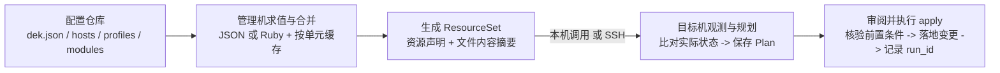

# dek 使用文档

**dek** 是一个用 Rust 编写的声明式主机配置管理器。你可以在一个 Git 仓库中统一管理多台主机，通过类似 NixOS 的层次化配置选项（option）描述每台主机的期望状态，由 dek 计算差异、生成可审阅的执行计划并幂等地落地变更。

首版面向 **Linux 管理机** 与 **Arch Linux 目标机**，同时支持**静态 JSON** 与 **Ruby DSL** 两种配置语言，以及**本机**和 **SSH 远程**两种执行模式。

## 核心特点

- **单仓库管理多主机**：一台主机一个入口，可自由混用静态 JSON 与 Ruby 配置；公共选项通过 `profile` 复用，并支持按需传参。
- **先规划、后审阅、再执行**：`dek plan` 实时观测目标机状态并生成带编号和前置条件的计划（Plan），`dek apply --plan <ID>` 严格按已审阅的内容和文件摘要执行。
- **按单元增量求值**：管理机按求值单元缓存声明采集、选项合并和模块展开结果。修改单台主机配置或静态部署文件（如 `Caddyfile`）时，未受影响的单元直接命中缓存，无需重复启动 Ruby。
- **无依赖远端管理**：SSH 模式下求值全部留在管理机，目标机无需安装 Ruby，也不必克隆配置仓库，只需在 `PATH` 中放好兼容版本的 `dek` 可执行文件。
- **贴合 Arch Linux 生态**：跟随 Arch 滚动更新，不维护包版本锁文件；支持 pacman 缺包补装、隔离数据库预览完整系统升级，以及通过 `paru` 构建和升级受管 AUR 包。
- **安全与可恢复**：移除配置声明默认仅停止管理，不做破坏性清理；私钥通过 `age` 加密入库、仅在目标机解密落盘；每次执行记录 `run_id`，支持 SSH 断线查询与失败续办。

## 工作原理一览

在 dek 中，运行命令的机器称为**管理机（Controller）**，被查看或修改的机器称为**目标机（Target）**；本机执行时两者为同一台设备。

## 文档导览

### 入门准备
- **[安装与环境要求](Installation-and-Requirements)**：管理机与目标机的软件要求、从源码构建安装，以及目标状态目录权限准备。
- **[快速上手](Quick-Start)**：从初始化仓库到完成首次 `plan`、`apply`、幂等验证和漂移修复。

### 编写主机配置
- **[配置仓库与 dek.json](Repository-and-Manifest)**：推荐目录结构、清单字段说明与主机选择规则。
- **[配置语言与求值](Configuration-Languages)**：静态 JSON 格式、Ruby DSL 语法、profile 复用、选项合并优先级以及受控外部输入。

### 内置模块
- **[软件包与应用](Builtin-Modules-Packages-Apps)**：Arch 官方仓库包、AUR 包、Git、OpenSSH 与 Caddy。
- **[账户、目录与 systemd](Builtin-Modules-System)**：Linux 本地用户与组、受管目录、系统级与用户级 systemd 服务和定时器。
- **[SSH 公钥与 age 密钥](Builtin-Modules-Keys-Secrets)**：用户 `authorized_keys` 受管块维护，以及 `age` 加密文件的离线加密、目标端解密与密钥轮换。

### 运维与进阶
- **[SSH 远程管理](SSH-Remote-Management)**：OpenSSH 集成、主机身份绑定（`targetId`）、远程事实采集、离线快照预览、交互终端与断线续办。
- **[Arch 滚动升级与 AUR](Arch-Upgrades-and-AUR)**：缺包补装与升级触发条件、审阅并执行整机升级、`paru` 非 root 构建账户配置与 AUR 包重建。
- **[缓存、状态与故障恢复](Caching-State-and-Recovery)**：管理机求值缓存、目标端 `/var/lib/dek` 目录结构、计划保留期（`retention.json`）、幂等性与服务通知重试。

### 扩展与查阅
- **[自定义模块开发](Custom-Modules)**：使用 `options.json` 和 Ruby 展开脚本封装自己的基础设施组件。
- **[CLI 命令参考](CLI-Reference)**：所有子命令、参数选项与 `--json` 自动化用法速查。
- **[常见问题与排障](Troubleshooting-and-FAQ)**：典型报错排查指引、停止管理与显式移除对照、核心术语速查。

> 若需要了解更深入的架构设计与决策背景，可参阅源码仓库中的 [`docs/design.md`](https://github.com/xingjianxu/dek/blob/master/docs/design.md) 与 [`docs/adr/`](https://github.com/xingjianxu/dek/tree/master/docs/adr)。
